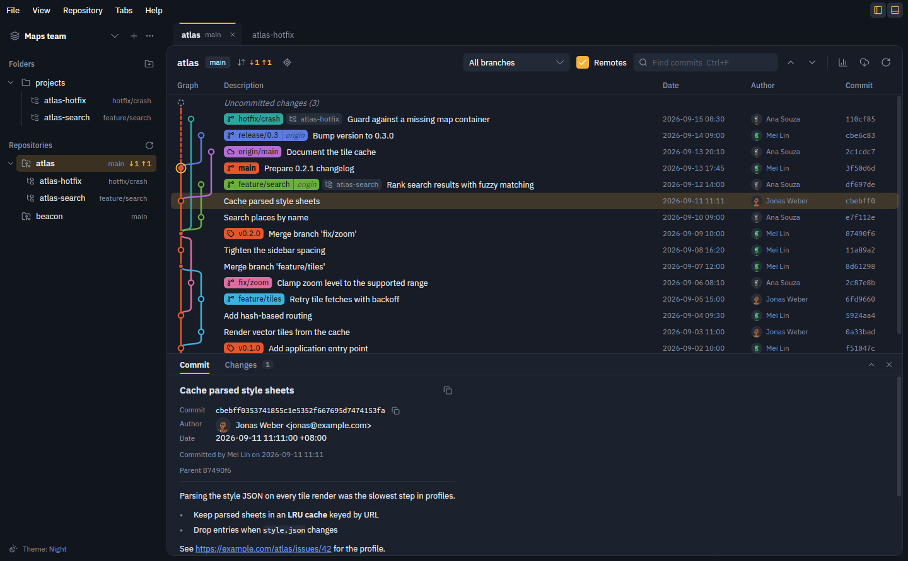
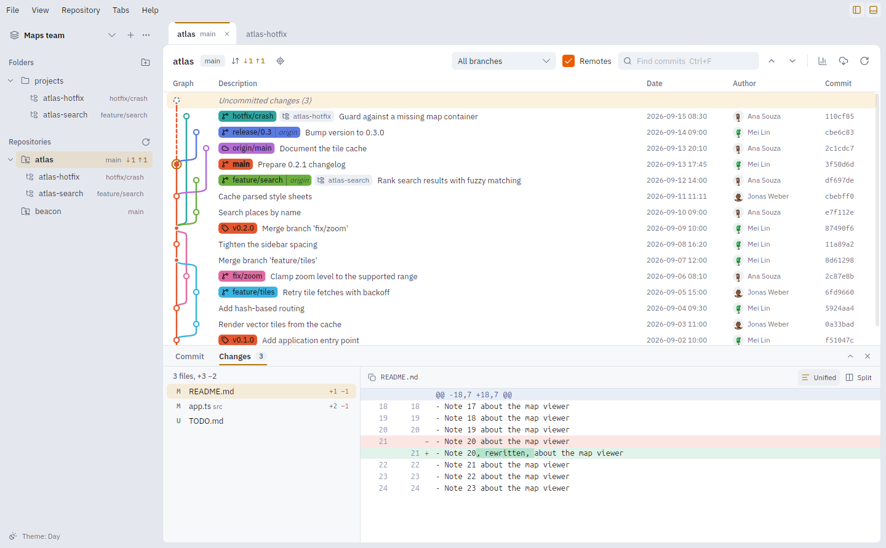
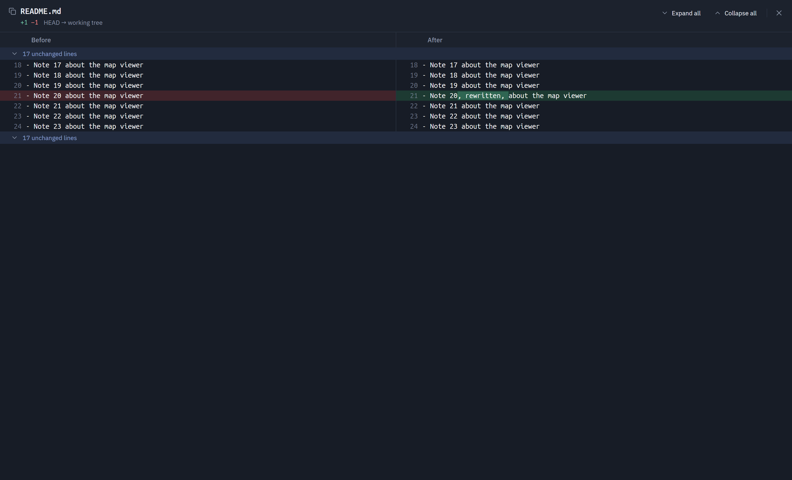
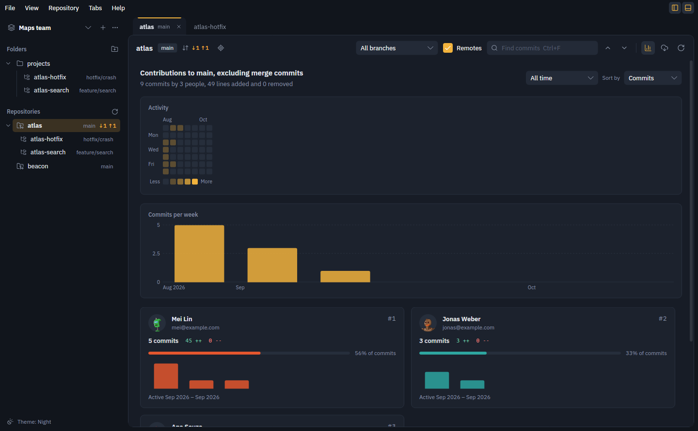
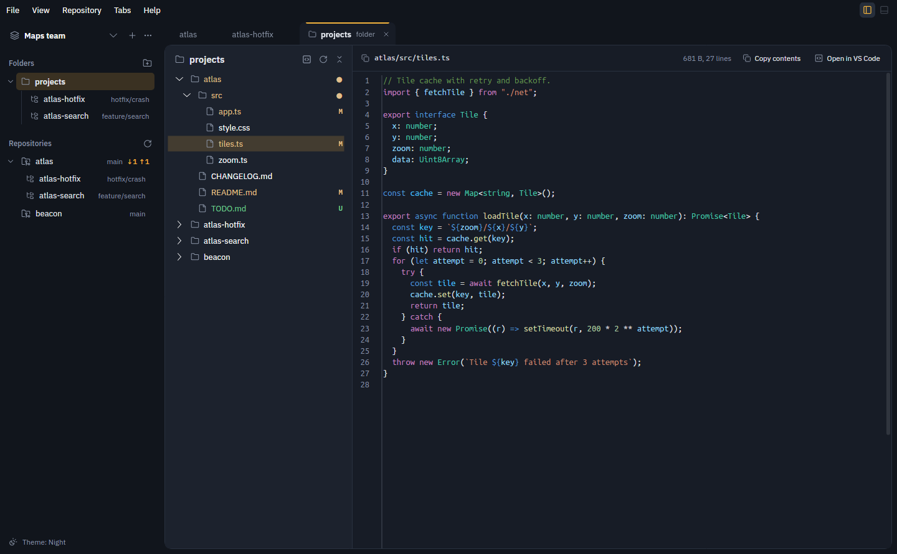

# Git Graph

A desktop git history viewer built with Avalonia and modelled on the
[Git Graph](https://github.com/mhutchie/vscode-git-graph) extension for VS Code.



- **Commit graph**: every branch, remote branch and tag on a colored lane, with uncommitted changes as a dashed row on top.
- **History**: filter by branch, show or hide remotes, find commits by message, author, hash or branch name, and scroll down to load older commits. The filter button adds fields to show only commits by an author, from a recent period, or touching a file or folder; the graph keeps its lines through a path filter.
- **Diffs**: files changed by a commit, the working tree, or between any two commits (Ctrl+click the second one). Diffs are computed with [DiffPlex](https://github.com/mmanela/diffplex), with changed words highlighted inside modified lines. View them unified or side by side, or double-click a file (or right-click it) to compare the whole file in a full window, as in Meld or Beyond Compare: each side shows its file as it is, bands across the middle join each change to its counterpart, F7 / Shift+F7 move to the next or previous change, a map beside the scroll bar shows every change (click to go there), the caret's line shows above its counterpart at the bottom, text selects across lines and copies, and unchanged stretches fold. Any diff line can be selected and copied. Code is coloured by language, as in VS Code. Under View, diffs can ignore whitespace and stop wrapping long lines (they then scroll sideways); the button above a diff opens the file in VS Code. A changed image shows its before and after side by side, with their sizes.
- **Stage and commit**: select the uncommitted changes row to see them grouped as staged changes, changes and merge conflicts. Stage, unstage or discard a file from the buttons on its row (or all of a group from its heading; Ctrl+click and Shift+click select several, and the arrow keys, Space to stage or unstage and Delete to discard work from the keyboard), or a single change from the Stage, Unstage and Discard buttons on each hunk of its diff. Write the message on the Commit tab and commit with the button or Ctrl+Enter; tick Amend last commit to replace the last commit (its message comes back to edit). With nothing staged, Commit offers to stage everything first.
- **Stash**: stash the uncommitted changes (with or without untracked files) from their row's context menu or the Repository menu. Each stash shows in the graph above the commit it was made on, with a `stash@{n}` label; select it to see what it saved, untracked files included, and right-click it to apply, pop or drop it, or to create a branch from it. Repository → Pop latest stash brings back the newest one.
- **File history and blame**: right-click a changed file (or a file in a folder tab), or use the clock button above a diff, to open the file's history: every commit that changed it, through renames, with that commit's diff. The Blame tab shows each line with the commit, author and date that last changed it; click a commit there to see it in the history.
- **Branch and tag labels**: each ref is a label filled with its lane colour, with a branch, tag or cloud icon; a local branch and its remote copies on the same commit share one label (`main │ origin`), and the checked-out branch is bold. The target button next to the branch jumps to HEAD. Right-click a label to check out, merge, rename or delete a branch, set its upstream, delete a remote branch from its remote, or push a tag.
- **Contributors**: the chart button shows who contributed to the current branch, like GitHub's Insights → Contributors: commits per week, then each person's commits, share, lines added and removed and weekly activity, over a chosen period and sorted by commits, additions or deletions (merge commits excluded, .mailmap respected).
- **Graph actions**: right-click a commit or branch to merge it into the current branch, cherry-pick it, rebase the current branch onto it, revert it, or reset the current branch to it (soft, mixed or hard). When a merge, cherry-pick, revert or rebase stops on conflicts, a bar above the graph offers to continue or abort it, and the conflicted files show under the uncommitted changes, where you can keep either side, open the file in VS Code, or stage it once resolved. Copy a commit's hash, or a changed file's path, from the context menus or the copy buttons.
- **Commit messages**: the body renders as Markdown, and links open in the browser. Author avatars come from GitHub for GitHub noreply addresses and from Gravatar otherwise (robohash for people without one), cached for a week; or choose initials under View → Author avatars, which sends nothing. Avatar requests use the proxy from the environment, or GNOME's system proxy when the app is started from the desktop.
- **Pull and push**: like VS Code's status bar, the toolbar and sidebar show commits to pull (↓) and push (↑) against each branch's upstream. Click it to sync (pull, then push) or to publish a branch that has no upstream; Pull and Push are also in the Repository menu, along with force push (with lease) and whether Pull merges, rebases or follows git config. Every repository in the open workspace is fetched quietly every 3 minutes (pick another interval or turn it off under View → Fetch automatically); new commits to pull show in a note and stay marked in the sidebar until you open the repository, and a repository whose fetch failed gets a warning icon with the reason in its tooltip.
- **Keyboard shortcuts**: defaults follow VS Code where it has the same command (Ctrl+B sidebar, Ctrl+J panel, Ctrl+W close tab, Ctrl+PageDown/PageUp and Alt+1…9 for tabs, Ctrl+K chords). Menus and button tooltips show them; File → Keyboard shortcuts (Ctrl+K Ctrl+S) lists every command and lets you record, reset or remove shortcuts, warning about clashes.
- **File states**: folder trees colour files and folders by their git state, as VS Code's explorer does: modified (M), added (A), untracked (U), renamed (R), conflicted (!), ignored dimmed, and a dot on folders with changes inside. Under Folders, linked worktrees are nested under the workspace folder that contains them (foldable, remembered). Right-click any repository or worktree under Repositories to browse its files or open it in VS Code, wherever it lives.
- **Folders**: click a workspace folder in the sidebar to browse its files in a tab: a tree on the left, the selected file on the right (read-only in AvaloniaEdit, with VS Code's syntax highlighting and Ctrl+F search, or images). Folders that only contain one folder show as one row, like `src/main/java/com/example` (View → Compact folders, as in VS Code). Each folder remembers which subfolders were open, which file was selected and how wide its tree was dragged. Right-click a folder, in the sidebar or the tree, to open it in VS Code or copy its path.
- **Worktrees**: each repository lists its linked worktrees in the sidebar. Add one from any commit or branch, open it in its own tab, or remove it. Commits checked out in another worktree are marked in the graph.
- **Workspaces**: named sets of folders. The sidebar's Folders and Repositories sections fold away from their headings, as in VS Code, and stay as left per workspace. Repositories inside them, up to three levels deep, are found automatically. Each workspace keeps its own open tabs.
- **Font size**: View → Font size makes all text larger or smaller, rows included (Ctrl+= and Ctrl+-, Ctrl+0 to reset, as VS Code's zoom), and is remembered.
- **Layout**: as in VS Code, a menu bar (File, View, Repository) with sidebar (Ctrl+B) and commit details panel (Ctrl+J) toggles on its right; the panel can also be maximized over the graph. As in VS Code, a single click in the sidebar opens a preview tab (in italics) that the next one replaces; double-click it, or the tab, to keep it open.

## Screenshots

**Diffs, in the day theme.** The working tree's changes, unified, with changed words marked inside modified lines.



**A file's diff in a full window.** Both files side by side, with each change joined across the middle and unchanged stretches folded away until opened.



**Contributors.** Activity by day and week for the current branch, then each person's commits and lines changed.



**Folders.** A workspace folder's files coloured by their git state, with the selected file highlighted in a read-only editor.



The screenshots come from the demo repositories: `make screenshots` renders them again.

## Run

```sh
dotnet run --project src/GitGraph.App
```

Needs the .NET 10 SDK and `git` on `PATH`. State is saved to `~/.config/GitGraph/state.json`
(`%APPDATA%\GitGraph\state.json` on Windows). Set `GITGRAPH_STATE` to use a different file, and `GITGRAPH_REDUCED_MOTION=1` to turn off animations. On Linux the app runs on X11 (XWayland on a Wayland desktop); `GITGRAPH_BACKEND=wayland` tries Avalonia's experimental native Wayland backend instead.

## Layout

| Project | What it holds |
| --- | --- |
| `src/GitGraph.Core` | git CLI wrapper and output parsers, graph lane layout, unified diff parsing, workspace persistence and repository discovery |
| `src/GitGraph.App` | Avalonia UI (MVVM with CommunityToolkit.Mvvm) |
| `tests/GitGraph.Core.Tests` | unit tests, plus integration tests against throwaway repositories |

```sh
dotnet test
```

## Releases

Every push runs CI (`.github/workflows/ci.yml`): formatting and analyzers (`dotnet format --verify-no-changes`, also `make lint`), a Release build and the tests.

To release, tag a version and push the tag:

```sh
make tag VERSION=0.1.0      # lint and test, then create the annotated tag v0.1.0
git push origin v0.1.0
```

The Release workflow (`.github/workflows/release.yml`) builds that version for each platform and publishes a GitHub release with notes generated from the commits. A version with a suffix, like `v0.2.0-beta.1`, becomes a pre-release.

| Platform | Files |
| --- | --- |
| Linux x64 | `GitGraph-<version>-linux-x64.tar.gz`, `gitgraph_<version>_amd64.deb` |
| Windows x64 | `GitGraph-<version>-win-x64.zip`, `GitGraph-<version>-win-x64-setup.exe` (Inno Setup; per-user or all users) |
| macOS (Apple Silicon) | `GitGraph-<version>-osx-arm64.dmg` |

The macOS app is only ad-hoc signed, not notarized, so the first launch needs right-click → Open. Help → About shows the version and the commit a build came from (local builds say `0.0.0-dev`), and its Check for updates button compares it with the latest release on GitHub. `make deb` builds the .deb locally.

## Make targets

`make` lists every target. The targets are defined in `mk/*.mk` and helper scripts live in `scripts/`.

| Target | What it does |
| --- | --- |
| `make build` / `make test` / `make run` | Build, test or run (`CONFIG=Release` for a release build) |
| `make publish RID=linux-x64` | Self-contained build in `artifacts/publish/<rid>` |
| `make install` | Install or update the app in `~/.local` (`PREFIX=...` to change): files in `opt/gitgraph`, a `gitgraph` command in `bin`, an app-menu entry and a desktop shortcut on Linux (`SHORTCUT=0` skips the shortcut) |
| `make uninstall` | Remove what `make install` added |
| `make demo-run` | Create demo repositories in `.demo/` and open the app on them |
| `make snapshot SELECT=3 COMPARE=6` | Render the demo window to `.demo/snapshot.png` |
| `make icons` | Re-render the PNG and ICO app icons from the drawing in `scripts/render_icon.py` (needs Pillow) |
| `make screenshots` | Render the README screenshots from the demo repositories into `docs/screenshots` |
| `make reindex` | Rebuild the generated indexes in `AGENTS.md` and `docs/` |

Fonts: the interface uses IBM Plex Sans. Code uses Ubuntu Sans Mono, Noto Sans CJK SC and DejaVu Sans Mono when installed (the same chain as the author's Ghostty terminal), falling back to IBM Plex Mono. Both Plex fonts are bundled under the SIL Open Font License (`src/GitGraph.App/Assets/Fonts/OFL.txt`). Icons are [Lucide](https://lucide.dev) (ISC license), through the Lucide.Avalonia package.
