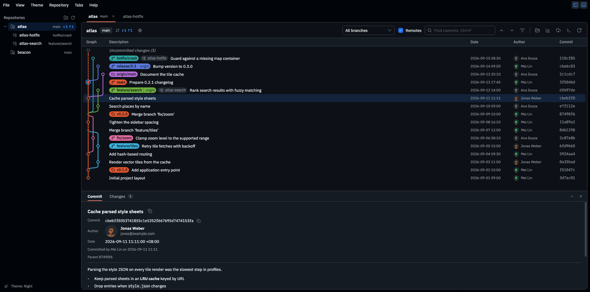
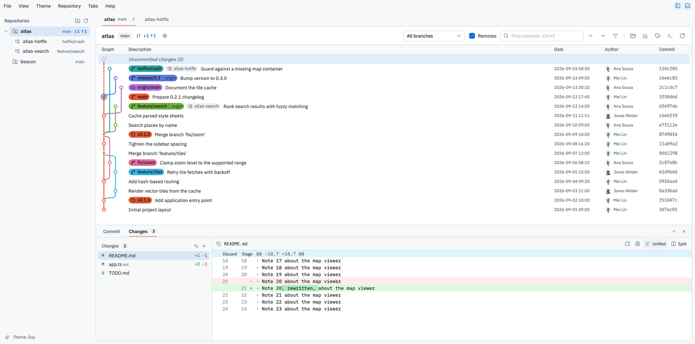
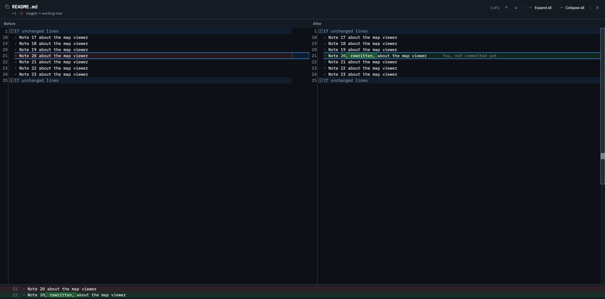
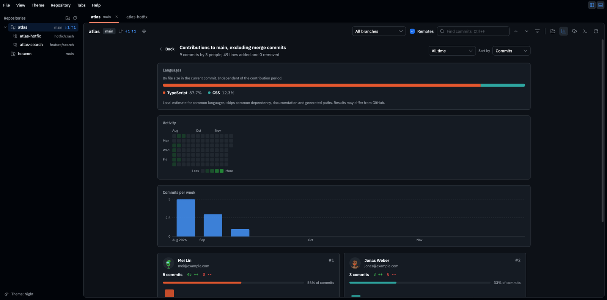
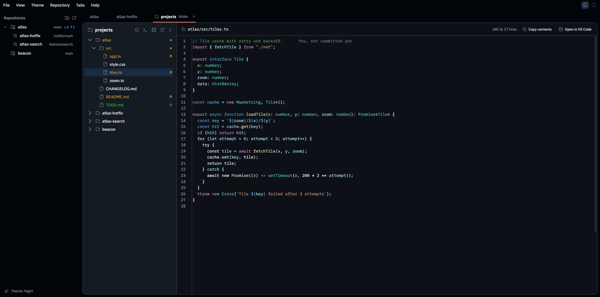

# Git Graph

A desktop git history viewer built with Avalonia and modelled on the [Git Graph](https://github.com/mhutchie/vscode-git-graph) extension for VS Code.



## Highlights

- **Commit graph & history**: Colored branch/tag lanes, merged local/remote labels, branch highlighting, infinite scroll, and rich filtering (`author:`, `path:`, `code:`, `since:`, `git log -S`).
- **Diffs & review comments**: Unified, side-by-side, and full-window diffs with word highlights, folded unchanged lines, image previews, file history/blame, and git-notes review comments (`refs/notes/gitgraph-comments`).
- **Staging & git operations**: File, hunk, and line-level staging, commit/amend, stashes, cherry-pick, revert, merge, interactive rebase, fold staged changes, undo/reflog, and background auto-fetch.
- **Repositories & worktrees**: Discover repositories from folders, manage linked worktrees, and track ahead/behind status from the sidebar.
- **File browser & code navigation**: Read-only code viewer with git state colors, syntax highlighting, and in-app tree-sitter go-to-definition, references, implementations, and fuzzy/symbol/`git grep` search.
- **Embedded terminal & customization**: Built-in shell per tab, VS Code-style keyboard shortcuts (`Ctrl+K Ctrl+S`), custom shell commands, "Open in" apps listed in `open-with.toml` next to the app state, and configurable avatars and themes.

See the [full feature guide](docs/features.md) for details on every capability.

## Screenshots

**Diffs (Day theme).** Working tree changes in unified view with word-level highlights.



**Full diff window.** Side-by-side comparison with folded unchanged stretches and inline blame notes.



**Contributors.** Language breakdown, daily activity heatmap, weekly commits, and per-author stats.



**File browser.** Git state indicators alongside a read-only editor with syntax highlighting.



Screenshots are generated from the demo repositories via `make screenshots`.

## Quick Start

Download a build for Linux, Windows, or macOS from [GitHub Releases](../../releases), or run from source (requires the .NET 10 SDK and `git` on `PATH`):

```sh
dotnet run --project src/GitGraph.App
```

## Documentation

- [Feature Guide](docs/features.md) — detailed walkthrough of all features and shortcuts.
- [Development & Releases](docs/development.md) — project layout, configuration, Make targets, CI/release workflow, and third-party licenses.
